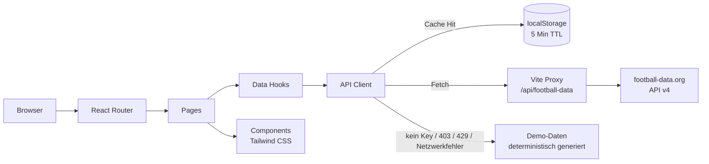

# UCL Center – UEFA Champions League SPA

[](https://github.com/mm2306/m450-ucl-project/actions/workflows/ci.yml)
[](https://mm2306.github.io/m450-ucl-project/)

Eine moderne Single-Page-Application für die UEFA Champions League: aktuelle Tabelle,
Spielplan, Ergebnisse und Spieldetails – gebaut mit React, TypeScript, Vite und Tailwind CSS.

Die App nutzt die kostenlose [football-data.org](https://www.football-data.org/)-API. Damit die
App auch ohne API-Key, bei CORS-Problemen oder nach Erreichen des Free-Tier-Limits vollständig
funktioniert, fällt sie automatisch auf realistische Demo-Daten zurück. Der Datenstatus wird in
der Oberfläche immer transparent angezeigt (`Live-Daten`, `Zwischengespeichert` oder `Demo-Daten`).

---

## Projektplanung & Scope

**Ziel:** Eine vollständige, responsive Champions-League-App mit zwei Datenquellen
(Tabelle + Spiele), Detailansicht und belastbarem Testkonzept.

**Umfang:**

- Drei Ansichten: Tabelle, Spielplan/Ergebnisse, Spieldetail.
- Zwei API-Endpunkte: `standings`, `matches`.
- Kein eigenes Backend, keine Authentifizierung, keine Datenbank.
- Fokus auf Frontend-Qualität, Fehlerrobustheit und automatisierte Tests.

**Bewusst nicht im Scope:**

- Live-Polling (Free-Tier-Limit: 10 Requests/Minute).
- Eigene Spielerdaten, Statistiken oder Wettquoten.
- Produktives Hosting der SPA inkl. eigenem API-Proxy.

**Zeitbox:** Das Projekt wurde so geschnitten, dass zuerst die App benutzbar war und danach
Testinfrastruktur, Reports und CI/CD folgten. Der Scope blieb bewusst klein, damit Tests,
Dokumentation und Pipeline vollständig statt nur oberflächlich umgesetzt werden konnten.

---

## KI-Nutzung

Die KI-Unterstützung wird transparent deklariert:

| Rolle | Einsatz im Projekt |
| --- | --- |
| Automatisches Erstellen von Code durch einen Agenten | Scaffolding, Komponenten, API-Layer, und Dokumentation wurden mit **opencode** erstellt. |

Die fachlichen Entscheidungen (Scope, Architektur, Testfälle, Datenmodell, Abnahme) lagen bei
mir. Der Code ist so strukturiert, dass jede Schicht einzeln erklärt und weiterentwickelt
werden kann.

---

## Architektur



**Schichten:**

1. **Pages/Routing** – Tabelle, Spiele, Detail, 404.
2. **Hooks** – Laden, Refresh, Loading-/Error-State.
3. **API-Layer** – Request-Queue, Cache, Timeout, Fehlerübersetzung, Fallback.
4. **Mocks/Demo-Daten** – realistische Fixtures für Offline-Betrieb und Tests.
5. **Vite-Proxy** – setzt den API-Key serverseitig, verhindert CORS und Token-Leaks.

---

## Features

- **Tabellen-Ansicht**
  - Ligaphase (36 Teams) und klassische Gruppenphasen.
  - Gruppen-Tabs bei mehreren Tabellen.
  - Qualifikationszonen (Top 8, Play-offs, ausgeschieden), Team-Suche und Formkurve.
- **Spielplan & Ergebnisse**
  - Gruppierung nach Kalendertag.
  - Filter nach Spieltag und Status (`Alle`, `Kommende`, `Ergebnisse`).
  - Live-Badges, Endstände, Anstoßzeiten und Stadion.
- **Spiel-Detailseite**
  - Scoreboard, Halbzeitstand, Phase, Datum, Stadion und Schiedsrichter.
  - Navigation zurück zu Tabelle und Spielplan.
- **Robustes Datenhandling**
  - Lade-Skeletons, Fehlerzustand mit Retry.
  - 429-Rate-Limit-Erkennung und verständliche Hinweise.
  - 5-Minuten-Cache, Request-Throttling (10/Minute), In-Flight-Deduplizierung.
  - Automatischer Fallback auf Cache oder Demo-Daten.
- **Design & UX**
  - Dunkles Champions-League-Design, vollständig responsiv.
  - Semantisches HTML, Fokus-Stile und ARIA-Labels.
- **Tests & CI/CD**
  - Unit-, Component-, Integration- und E2E-Tests.
  - JUnit-, Coverage- und Playwright-HTML-Reports.
  - GitHub Actions auf `main` inklusive Deployment des Coverage-Reports auf GitHub Pages.

---

## Tech Stack

| Bereich | Technologie |
| --- | --- |
| Framework | React 19 + TypeScript |
| Build Tool | Vite 7 |
| Package Manager | Yarn 1.22 (Classic) |
| Styling | Tailwind CSS 3 |
| Routing | React Router 7 |
| Unit/Integration | Vitest + React Testing Library + MSW |
| E2E | Playwright |
| API | football-data.org v4 (`Competition: CL`) |
| CI/CD | GitHub Actions + GitHub Pages |

---

## Schnellstart

### Voraussetzungen

- Node.js **20.19+** oder **22.12+** (empfohlen: Node 22)
- Yarn **1.22+**

### Installation

```bash
yarn install
```

### API-Key hinterlegen (optional, aber empfohlen)

1. Kostenlosen Account auf [football-data.org](https://www.football-data.org/client/register)
   anlegen.
2. Den `X-Auth-Token` kopieren.
3. `.env.example` nach `.env` kopieren und Key eintragen:

```bash
cp .env.example .env
```

```dotenv
VITE_FOOTBALL_DATA_API_KEY=auth_token
```

> Ohne Key startet die App trotzdem vollständig – dann werden Demo-Daten verwendet.
> Die `.env` ist per `.gitignore` ausgeschlossen und wird nie committet.

### Entwicklungsserver

```bash
yarn dev
```

App: **http://localhost:5173**

### Produktions-Build & Vorschau

```bash
yarn build
yarn preview
```

Vorschau: **http://localhost:4173**

Der Key muss beim Build in der `.env` stehen, damit der API-Modus im Client aktiviert wird.
Der Token selbst wird ausschließlich vom Vite-Proxy gesendet.

---

## API & Rate Limits

### Endpunkte

```text
GET /v4/competitions/CL/standings
GET /v4/competitions/CL/matches
```

Der Client nutzt relative Pfade über den Proxy:

```text
/api/football-data/competitions/CL/standings
/api/football-data/competitions/CL/matches
```

### Free-Tier-Strategie (10 Requests/Minute)

- **Cache:** 5 Minuten in `localStorage`; Navigation löst meist keinen Request aus.
- **Request-Queue:** seriell, maximal 10 Requests pro 60 Sekunden.
- **Deduplizierung:** parallele identische Requests teilen sich eine Promise.
- **Stale-While-Error:** bei Fehlern/429 werden zuerst Cache-Daten angezeigt.
- **Demo-Fallback:** ohne Cache werden deterministische Demo-Daten geliefert.
- **Refresh:** der Button umgeht den Cache bewusst.

### CORS & Deployment

football-data.org erlaubt keine beliebigen Browser-Origins für Requests mit `X-Auth-Token`.
Deshalb läuft der Zugriff über den Vite-Proxy (Dev und Preview). Bei statischem Hosting der SPA
ist ein eigener API-Proxy nötig (Serverless Function, Edge Function oder Node-Server), der den
Token serverseitig ergänzt. Die Proxy-Basis kann überschrieben werden:

```dotenv
VITE_FOOTBALL_DATA_API_URL=https://fake-proxy.example.com/v4
```

> Der GitHub-Pages-Deploy dieser Pipeline veröffentlicht den **Coverage-Report**, nicht die SPA.

---

## Testkonzept

### Testpyramide

| Ebene | Anzahl | Ziel | Werkzeug | Ort |
| --- | ---: | --- | --- | --- |
| Unit (Logik) | 13 | Datums-/Status-/Tabellenlogik | Vitest | `src/lib/utils.test.ts` |
| Unit/Component | 7 | Rendering, Zonen, Scores, Form | Vitest + RTL | `src/components/*.test.tsx` |
| Integration | 7 | Laden, Navigation, Filter, Suche, 429, 404 | Vitest + RTL + MSW | `src/test/integration.test.tsx` |
| E2E | 2 | echter Browser-User-Journey | Playwright | `e2e/ucl.spec.ts` |

**Gesamt:** 27 Unit-/Component-/Integrationstests + 2 E2E-Tests.

### Was wird geprüft?

- **Unit:** deutsche Datums-/Zeitformatierung, Spieltags-Gruppierung, Status-Mapping,
  Tabellen-Normalisierung, Zonenlogik, Tordifferenz, Initialen.
- **Component:** Tabellenzeile (Stats, Form, Zonenfarben), MatchCard (Endstand, Anstoß, Live).
- **Integration:** Tabelle lädt aus der API, Lade-Skeleton, Navigation zum Spielplan,
  Spieltag-/Status-Filter, Team-Suche, Spieldetail, 429-Fallback, 404-Routen.
- **E2E:** Startseite mit 36 Teams, Spielplan mit 144 Spielen, Filter auf Spieltag 3,
  Detailseite öffnen und zurück navigieren.

### Mocking der Schnittstellen

- **MSW (Mock Service Worker)** fängt im Integrationstest alle Requests an
  `/api/football-data/...` ab und liefert echte HTTP-Antworten aus den Demo-Fixtures.
- **Playwright `page.route`** mockt dieselben Endpunkte im Browser.
- Dadurch werden **keine echten API-Requests** ausgeführt und kein Rate-Limit verbraucht.
- Fehlerfälle (z. B. HTTP 429) werden gezielt pro Test mit `server.use(...)` überschrieben.

### Testdaten

- Deterministischer, seeded Demo-Datengenerator (`src/mocks/footballData.ts`).
- Kleine, fokussierte Builder in `src/test/fixtures.ts`.
- Tests setzen `localStorage` und den MSW-Server vor/nach jedem Test zurück.

### Exit-Kriterien

Ein Lauf gilt als erfolgreich, wenn:

1. `yarn typecheck` ohne Fehler durchläuft,
2. alle Unit-/Integrationstests grün sind,
3. alle E2E-Tests grün sind,
4. der Production-Build erfolgreich ist,
5. Coverage- und Test-Reports erzeugt wurden.

### Testresultate & Reports

| Report | Lokal | CI |
| --- | --- | --- |
| Vitest JUnit | `reports/vitest/junit.xml` | Artifact `vitest-report` |
| Coverage HTML/LCOV | `coverage/index.html`, `coverage/lcov.info` | Artifact `coverage-report` + GitHub Pages |
| Playwright HTML | `playwright-report/index.html` | Artifact `playwright-report` |
| Playwright JUnit | `reports/playwright/junit.xml` | Artifact `playwright-report` |

**Links:**

- CI-Pipeline: <https://github.com/mm2306/m450-ucl-project/actions/workflows/ci.yml>
- Coverage-Report (GitHub Pages): <https://mm2306.github.io/m450-ucl-project/>

---

## Test Driven Development (TDD)

TDD wurde bei der Kernlogik und den Komponenten angewendet:

1. **Red:** Tests für Datums-/Tabellenlogik, Tabellenzeile und MatchCard wurden zuerst
   geschrieben und schlugen fehl, weil die Implementierung noch nicht existierte.
2. **Green:** Typen, Utilities, Demo-Daten und Komponenten wurden implementiert, bis die Tests
   grün waren.
3. **Refactor:** Doppelte Formatierungslogik wurde in `src/lib/utils.ts` zentralisiert;
   Test-Fixtures wurden in Builder ausgelagert.

Die Commit-Historie ist bewusst so aufgebaut, dass Test-Commits vor den zugehörigen
Implementierungs-Commits liegen. Integrationstests kamen vor dem finalen Routing/Entrypoint.

**Reflexion:** TDD hat besonders bei `normalizeStandings`, `getTableZone` und der
Status-Logik geholfen, Randfälle (Gruppenphase vs. Ligaphase, 429, leere Form) früh sichtbar zu
machen. Bei rein visuellen Tailwind-Anpassungen war TDD weniger hilfreich; dort dominierten
manuelle Prüfung und Screenshots.

---

## CI/CD-Pipeline

Workflow: [`.github/workflows/ci.yml`](.github/workflows/ci.yml)

**Trigger:** Push auf `main` und Pull Requests gegen `main`.

**Stages im Job `build-test`:**

1. Checkout + Node.js 22 + Yarn-Cache.
2. `yarn install --frozen-lockfile`.
3. `yarn typecheck`.
4. `yarn test:coverage` → Unit-/Integrationstests, JUnit-XML, Coverage.
5. `yarn build`.
6. Playwright Chromium installieren.
7. `yarn test:e2e` → HTML- und JUnit-Report.
8. Artifacts hochladen: Vitest, Coverage, Playwright.
9. Auf `main`: Coverage als GitHub-Pages-Artefakt vorbereiten.

**Job `deploy`:** läuft nur bei Push auf `main`, veröffentlicht den Coverage-Report auf
GitHub Pages.

Damit sind Tests und Reports bei jedem Deploy auf `main` automatisiert und einsehbar.

---

## Code Reviews & Reflexion

Für Änderungen gilt der Ablauf: Feature-Branch → Pull Request → Review → Merge nach `main`.
Die Review-Checkliste umfasst:

- Sind Tests vorhanden und aussagekräftig (Happy Path + Fehlerfall)?
- Werden Schnittstellen gemockt statt echte API-Calls ausgeführt?
- Ist der Code typisiert, verständlich und ohne toten Code?
- Sind Loading-, Error- und Empty-States abgedeckt?
- Ist die UI responsiv und barrierefrei bedienbar?

**Reflexion:** Der größte Nutzen lag in kleinen, testbaren Einheiten (Utilities, API-Layer,
Komponenten). Besonders wertvoll waren die Fehlerfall-Tests für 429 und die E2E-Tests, weil sie
das Zusammenspiel von Routing, API-Fallback und UI abdecken. Aufwändig war die korrekte
Behandlung des Free-Tier-Limits; die Lösung mit Cache, Queue und Demo-Fallback hält die App
jederzeit benutzbar.

---

## Projektstruktur

```text
.
├── .github/workflows/ci.yml     # CI/CD, Tests, Reports, Pages-Deploy
├── e2e/ucl.spec.ts              # Playwright E2E-Tests
├── public/favicon.svg
├── src/
│   ├── components/              # Layout, Tabelle, MatchCard, Filter, States, Icons
│   ├── hooks/useCompetitionData.ts
│   ├── lib/
│   │   ├── api.ts               # API-Client, Queue, Cache, Fallbacks
│   │   ├── types.ts             # football-data.org Typen
│   │   └── utils.ts             # Formatierung, Filter, Tabellen-Logik
│   ├── mocks/footballData.ts    # Demo-Saison (Teams, Spiele, Tabelle)
│   ├── pages/                   # Tabelle, Spiele, Detail, 404
│   ├── test/                    # MSW-Server, Setup, Fixtures, Integrationstests
│   ├── App.tsx
│   ├── index.css
│   └── main.tsx
├── .env.example
├── playwright.config.ts
├── tailwind.config.js
├── vite.config.ts
└── README.md
```

---

## Commands

| Befehl | Beschreibung |
| --- | --- |
| `yarn dev` | Dev-Server mit HMR auf Port 5173 |
| `yarn build` | Typecheck + Production-Build nach `dist/` |
| `yarn preview` | Vorschau des Production-Builds auf Port 4173 |
| `yarn typecheck` | TypeScript-Prüfung ohne Build |
| `yarn test` | Unit-, Component- & Integrationstests |
| `yarn test:watch` | Tests im Watch-Modus |
| `yarn test:coverage` | Tests + Coverage + JUnit-Report |
| `yarn test:e2e` | Playwright-E2E-Tests inkl. HTML-/JUnit-Report |
| `yarn test:e2e:ui` | Playwright im interaktiven UI-Modus |

---

## Design-Entscheidungen

- **Kein Token im Frontend:** Der Key wird ausschließlich vom Vite-Proxy verwendet.
- **Eigener Daten-Layer:** Für zwei Endpunkte reicht ein kleiner Client mit Cache/Queue.
- **Demo-Daten als First-Class-Fallback:** Offline-, CORS- und Rate-Limit-Fälle bleiben nutzbar.
- **Transparenz:** Der Datenstatus ist in der UI immer sichtbar.
- **Tests ohne API-Quota:** MSW und Playwright-Routen machen die Testläufe deterministisch.

---

## Bekannte Einschränkungen

- Die Free-API liefert teils keine Stadiondaten, keine Formkurve und keine Live-Minute.
- Kein automatisches Polling für Live-Spiele (bewusst wegen des Limits).
- Bei statischem Hosting der SPA ist ein eigener API-Proxy erforderlich.
- Demo-Daten sind synthetisch und bilden nicht die echte Saison ab.
- GitHub Pages hostet in dieser Pipeline den Coverage-Report, nicht die SPA.

---